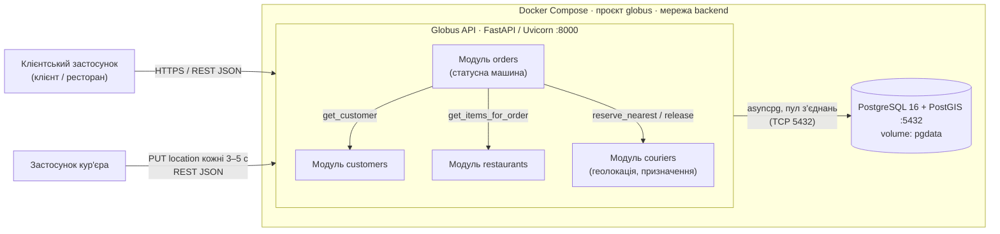
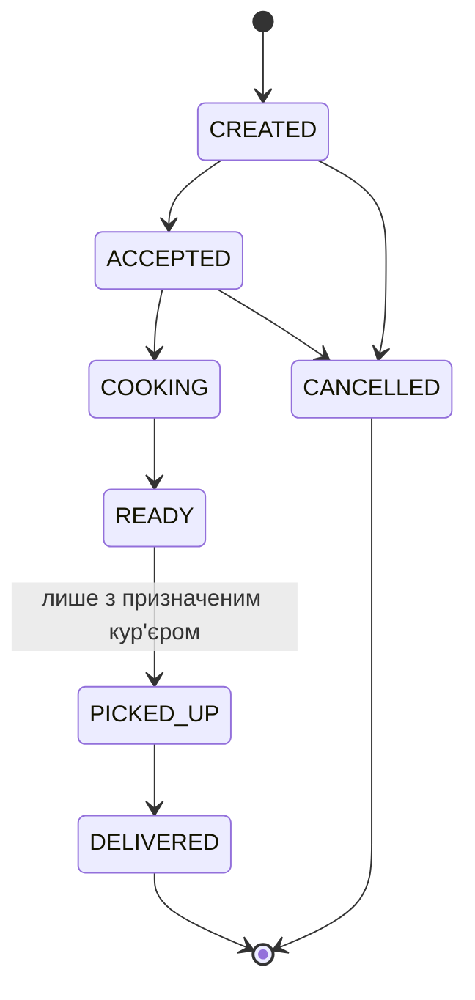

# Globus

**Globus** — високонавантажений сервіс доставки їжі з відстеженням кур'єрів у реальному часі.
Навчальний проєкт з дисципліни «Інженерія високонавантажених систем».

**Стек:** Python 3.12, FastAPI, SQLAlchemy 2.0 (async) + asyncpg, Alembic, PostgreSQL 16 + PostGIS, Docker Compose.

---

## Запуск

Потрібен лише Docker (Docker Desktop на Windows/macOS).

```bash
git clone <repo-url> && cd globus
docker compose up --build
```

Ця команда піднімає PostgreSQL, чекає його готовності (healthcheck), автоматично застосовує міграції та запускає API.

- API: http://localhost:8000
- Swagger UI: http://localhost:8000/docs
- OpenAPI-специфікація: http://localhost:8000/openapi.json

Демо-дані (3 ресторани з меню, 5 кур'єрів, 2 клієнти):

```bash
docker compose exec app python -m app.seed
```

> На Mac з Apple Silicon образ `postgis/postgis` запускається через емуляцію x86. Це працює, але повільніше.

### Перевірка збереження даних (persistence)

```bash
docker compose restart db          # перезапуск контейнера БД
curl localhost:8000/orders/1       # дані на місці
docker compose down && docker compose up -d   # навіть повне перестворення контейнерів
curl localhost:8000/orders/1       # дані на місці, бо лежать у volume pgdata
```

Дані видаляються лише явно: `docker compose down -v`.

---

## Архітектура

**Стиль: модульний моноліт.** Один backend-застосунок, розділений на модулі з чіткими межами: кожен модуль має власні моделі, схеми, сервіс і роутер, а інші модулі звертаються до нього лише через публічні функції сервісного шару (не до його таблиць напряму). Це дає простоту розгортання й транзакційну цілісність на старті, а межі модулів є готовими лініями розрізу для виділення мікросервісів у наступних лабораторних.

### Діаграма контейнерів (C4, Container level)



### Модель даних

```mermaid
erDiagram
    CUSTOMER ||--o{ ORDER : places
    RESTAURANT ||--o{ MENU_ITEM : has
    RESTAURANT ||--o{ ORDER : receives
    COURIER |o--o{ ORDER : delivers
    ORDER ||--|{ ORDER_ITEM : contains
    MENU_ITEM ||--o{ ORDER_ITEM : "snapshot of"

    CUSTOMER { int id PK string name; string phone UK }
    RESTAURANT { int id PK; string name; string address; float lat; float lng; bool is_active }
    MENU_ITEM { int id PK; int restaurant_id FK; string name; decimal price; bool is_available }
    COURIER { int id PK; string name; string phone UK; enum status; float lat; float lng; timestamp location_updated_at }
    ORDER { int id PK; int customer_id FK; int restaurant_id FK; int courier_id FK; enum status; decimal total_amount }
    ORDER_ITEM { int id PK; int order_id FK; int menu_item_id FK; string name; decimal unit_price; int quantity }
```

Рішення щодо даних:
- `order_items` зберігає **знімок** назви й ціни: зміна меню не змінює історію замовлень.
- Сума замовлення рахується **на сервері** з цін у БД, клієнту не довіряємо.
- Геопошук через PostGIS: координати в колонках `lat/lng`, над виразом `geography`-точки побудовано **GiST-індекси** (`ix_restaurants_location`, `ix_couriers_location`).

### Статусна машина замовлення



Недопустимий перехід повертає `409 Conflict`. Кур'єра можна призначити в статусах ACCEPTED / COOKING / READY. При DELIVERED або CANCELLED кур'єр автоматично звільняється.

---

## API

Повна інтерактивна специфікація: **http://localhost:8000/docs**.

| Метод | Endpoint | Опис |
|---|---|---|
| POST | `/customers` | Реєстрація клієнта |
| GET | `/customers/{id}` | Дані клієнта |
| POST | `/restaurants` | Створення ресторану |
| GET | `/restaurants?lat=&lng=&radius_m=` | Список або **геопошук** ресторанів поруч (з відстанню) |
| GET / PATCH | `/restaurants/{id}` | Отримання / оновлення ресторану |
| POST / GET | `/restaurants/{id}/menu` | Додавання страви / меню ресторану |
| PATCH | `/menu-items/{id}` | Оновлення страви (ціна, доступність) |
| POST | `/orders` | **Створення замовлення** з валідацією та розрахунком суми |
| GET | `/orders?customer_id=&status=` | Список замовлень з фільтрами й пагінацією |
| GET | `/orders/{id}` | Замовлення з позиціями |
| PATCH | `/orders/{id}/status` | **Зміна статусу** через статусну машину |
| POST | `/orders/{id}/assign-courier` | **Призначення найближчого вільного кур'єра** |
| POST | `/couriers` | Реєстрація кур'єра |
| GET | `/couriers/{id}` | Дані кур'єра |
| PUT | `/couriers/{id}/location` | **Оновлення геопозиції** |
| PATCH | `/couriers/{id}/status` | Вихід на лінію (AVAILABLE) / завершення зміни (OFFLINE) |
| GET | `/health` | Перевірка стану сервісу та БД |

**Коди відповідей:** `200`/`201` успіх; `400` некоректний запит; `404` ресурс не знайдено; `409` конфлікт стану (недопустимий перехід статусу, кур'єр уже призначений, дублікат телефону); `422` невалідні дані або порушення бізнес-правила (страва з іншого ресторану, ресторан неактивний).

Формат бізнес-помилки:
```json
{"error": {"code": "conflict", "message": "Cannot change order status from CREATED to READY"}}
```

### Демо-сценарій (curl)

```bash
# Ресторани поруч з точкою
curl "localhost:8000/restaurants?lat=50.445&lng=30.52&radius_m=3000"

# Створити замовлення
curl -X POST localhost:8000/orders -H "Content-Type: application/json" -d '{
  "customer_id": 1, "restaurant_id": 1,
  "delivery_address": "вул. Прикладна, 1", "delivery_lat": 50.44, "delivery_lng": 30.51,
  "items": [{"menu_item_id": 1, "quantity": 2}, {"menu_item_id": 2, "quantity": 1}]
}'

# Прийняти й призначити кур'єра
curl -X PATCH localhost:8000/orders/1/status -H "Content-Type: application/json" -d '{"status":"ACCEPTED"}'
curl -X POST  localhost:8000/orders/1/assign-courier

# Кур'єр надсилає координати
curl -X PUT localhost:8000/couriers/1/location -H "Content-Type: application/json" -d '{"lat":50.446,"lng":30.521}'
```

---

## Піковий сценарій навантаження (High-Load Scenario)

**Обідній пік (12:00–14:00).** Одночасно активні ~5 000 кур'єрів, кожен надсилає `PUT /couriers/{id}/location` кожні 3–5 с, тобто **≈1 000–1 700 записів/с** лише від геолокації. Паралельно хвиля `POST /orders` і `POST /orders/{id}/assign-courier` (геопошук найближчого кур'єра з блокуванням рядка), а клієнти періодично опитують `GET /orders/{id}`, щоб побачити статус.

Найбільш ресурсоємна комбінація: інтенсивний потік записів у таблицю `couriers` + конкурентні геозапити з блокуванням до тієї ж таблиці.

---

## Аналіз вузьких місць (Bottleneck Analysis)

### 1. Оновлення геопозиції кур'єрів: `PUT /couriers/{id}/location`

- **Причина.** Кожне оновлення є транзакцією UPDATE у PostgreSQL: запис у WAL, fsync при коміті, створення нової версії рядка (MVCC). Через MVCC оновлюються також **усі індекси** таблиці, включно з GiST-індексом геолокації, який дорожчий за B-tree. Мертві версії рядків накопичуються швидше, ніж їх прибирає autovacuum (table bloat). Кожен запит займає з'єднання з пулу (у нас 10 + 5 overflow).
- **Симптоматика.** Зростання p99 latency для всіх ендпоінтів (вони ділять той самий пул з'єднань і диск), помилки очікування з'єднання (`QueuePool limit ... timeout`, Connection Pool Exhaustion), високий I/O Wait на сервері БД, падіння throughput при зростанні кількості кур'єрів.

### 2. Призначення кур'єра: `POST /orders/{id}/assign-courier`

- **Причина.** Геопошук + блокування рядка `FOR UPDATE SKIP LOCKED` у тій самій таблиці, яку постійно оновлює пункт 1 (Lock Contention). Під час піку багато замовлень з одного району конкурують за тих самих найближчих кур'єрів: запити пропускають заблоковані рядки й беруть дальших кандидатів, а коли кандидати закінчуються, отримують `409`. Сам геозапит з KNN-сортуванням навантажує CPU БД, а його результат швидко застаріває, бо координати змінюються кожні кілька секунд.
- **Симптоматика.** Зростання частки відповідей `409 No available couriers` при фактично вільних кур'єрах далі від ресторану, зростання CPU БД, збільшення тривалості транзакцій і p99 latency для цього ендпоінта.

### 3. Опитування статусу замовлення: `GET /orders/{id}`

- **Причина.** Клієнти дізнаються про зміну статусу через polling (запит кожні кілька секунд), що множить кількість читань на кількість активних замовлень, хоча статус змінюється рідко. Кожен запит виконує 2 SQL-запити (замовлення + позиції через `selectinload`); без явного eager loading це був би класичний N+1 (у коді заборонено через `lazy="raise"`). Кешу немає, тому кожне читання йде в БД.
- **Симптоматика.** RPS на читання росте лінійно з кількістю активних замовлень, конкуренція за пул з'єднань з операціями запису, зростання latency для всіх користувачів без реальної зміни даних.

### 4. Геопошук ресторанів: `GET /restaurants?lat=&lng=`

- **Причина.** Найпопулярніший запит клієнтів (відкриття застосунку). Обчислення `ST_Distance` для кожного кандидата в радіусі; з великим радіусом у щільному місті індекс повертає багато рядків. Результати однакові для сусідніх точок, але щоразу перераховуються.
- **Симптоматика.** Зростання CPU БД, деградація p95/p99 при великих `radius_m`.

**Напрями оптимізації на наступні етапи:** зберігання актуальних координат кур'єрів у Redis (GEOADD / GEOSEARCH) з періодичним скиданням у БД; кешування меню та результатів геопошуку; асинхронна обробка через чергу повідомлень; заміна polling на WebSocket / SSE; горизонтальне масштабування API за балансувальником; read-репліки PostgreSQL.

---

## Структура проєкту

```
app/
  core/            конфігурація, підключення до БД, обробка помилок, геохелпери
  modules/
    customers/     клієнти
    restaurants/   ресторани, меню, геопошук
    couriers/      кур'єри, геолокація, резервування кур'єра
    orders/        замовлення, статусна машина, призначення кур'єра
  main.py          збирання застосунку
  seed.py          демо-дані
migrations/        міграції Alembic (схема БД, PostGIS, індекси)
Dockerfile
docker-compose.yml
```

Кожен модуль: `models.py` (ORM), `schemas.py` (валідація Pydantic), `service.py` (бізнес-логіка), `router.py` (HTTP-шар).

---

## Розподіл відповідальності

| Компонент | Заньковський В.В. | Бренькач Д.В. |
|---|-------------------|---------------|
| Модулі `restaurants`, `customers` | **R**             | C             |
| Модуль `orders`, статусна машина | **R**             | C             |
| Обробка помилок, валідація, OpenAPI | **R**             | C             |
| Модуль `couriers`, геопошук, призначення кур'єра | C                 | **R**         |
| Схема БД, міграції, індекси | C                 | **R**         |
| Docker / docker-compose, відтворюваність | C                 | **R**         |
| Архітектурна схема, аналіз вузьких місць | **R**             | **R**         |
| Code review | **R**             | **R**         |

**R** — відповідальний виконавець, **C** — консультує та переглядає код.
