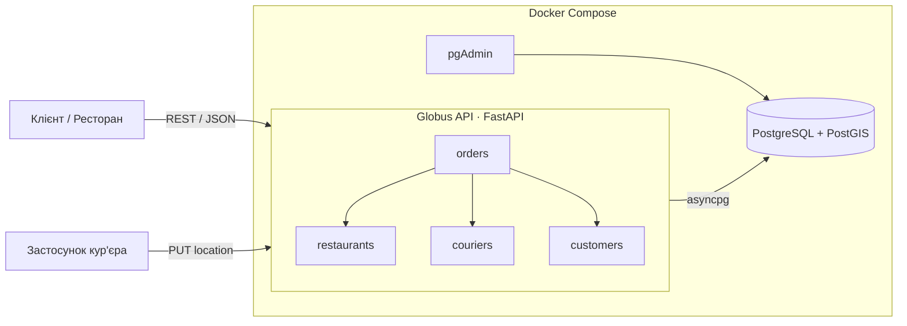
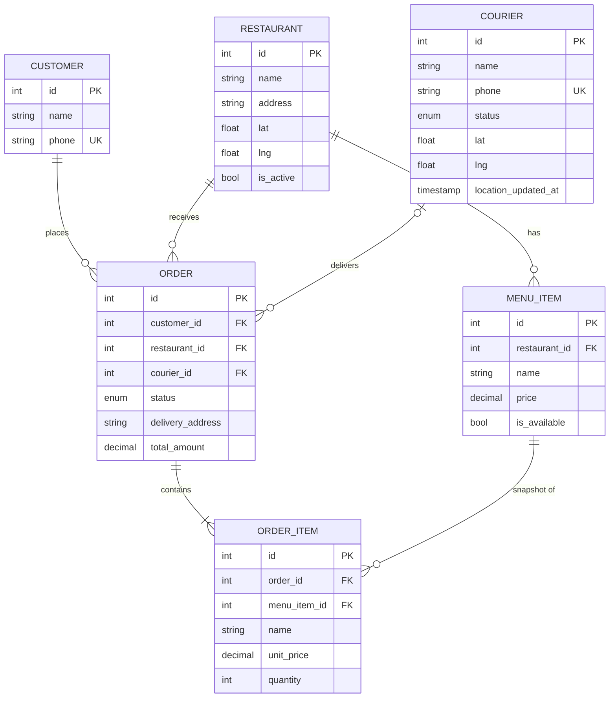
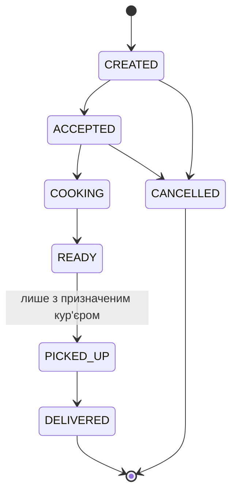
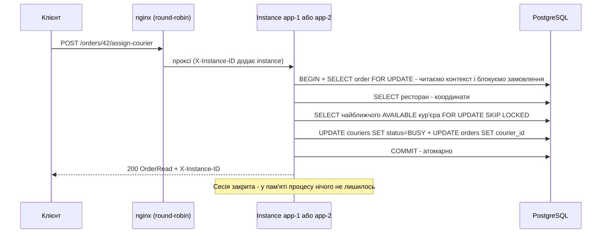
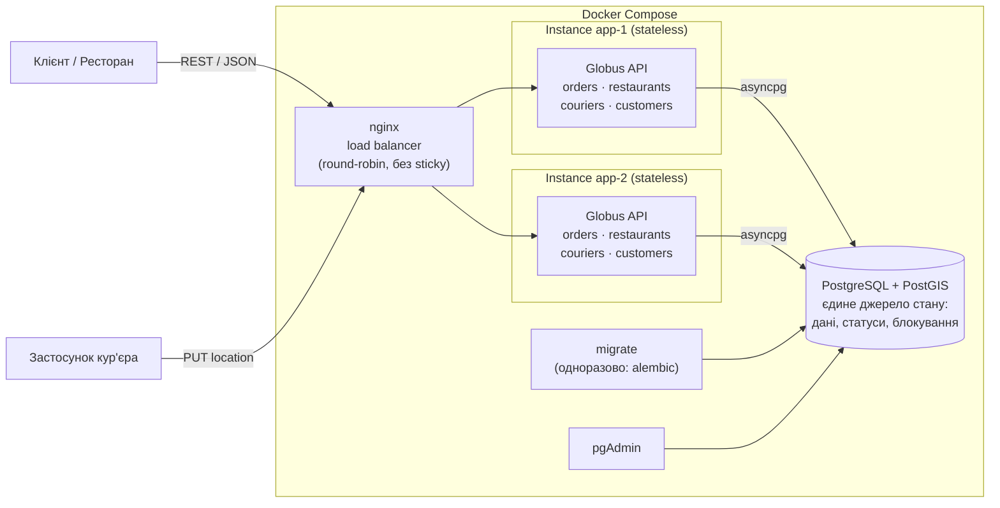
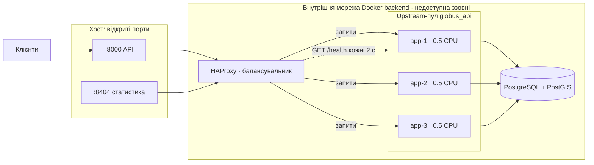
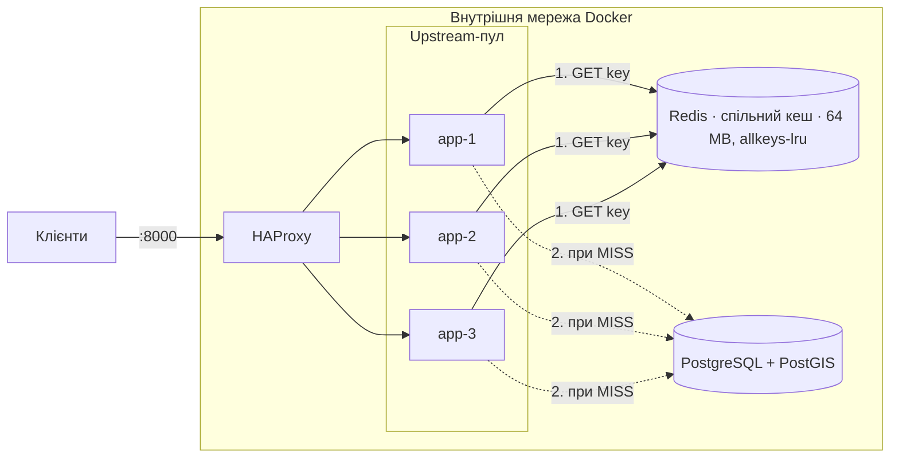
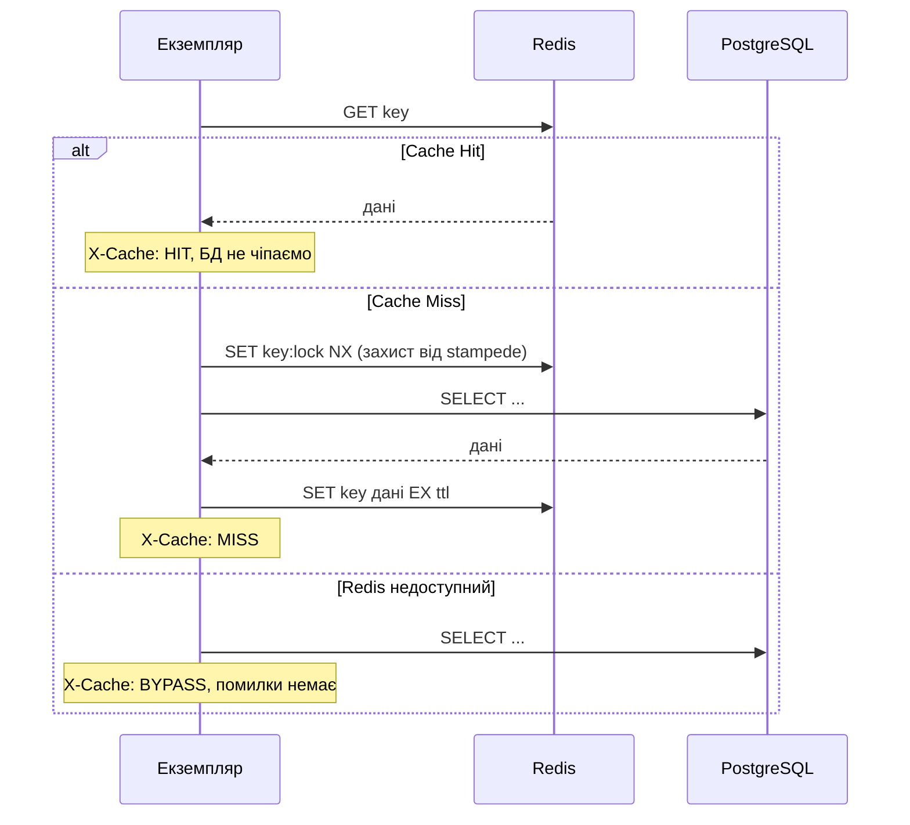

# Globus

**Globus** — високонавантажений сервіс доставки їжі з відстеженням кур'єрів у реальному часі.
Навчальний проєкт з дисципліни «Інженерія високонавантажених систем».

**Стек:** Python 3.12, FastAPI, SQLAlchemy 2.0 (async) + asyncpg, Alembic, PostgreSQL 16 + PostGIS, HAProxy 2.8, Docker Compose.

---

## Запуск

Потрібен лише Docker (Docker Desktop на Windows/macOS).

```bash
git clone <repo-url> && cd globus
docker compose up --build
```

Ця команда піднімає PostgreSQL, чекає його готовності (healthcheck), один раз застосовує міграції (сервіс `migrate`), запускає **пул із трьох instances API** (`app1`, `app2`, `app3`) та балансувальник **HAProxy**. Назовні відкрито лише балансувальник (див. розділ «Лабораторна 3»).

- API (єдина точка входу, через балансувальник): http://localhost:8000
- Swagger UI: http://localhost:8000/docs
- Статистика балансувальника (стан вузлів, розподіл запитів): http://localhost:8404
- pgAdmin: http://localhost:5050 (сервер Globus уже налаштований, пароль `globus`)

Прямий доступ до окремих instances (8001–8003) і БД (5434) з ЛР2 тепер вмикається лише окремим файлом для налагодження:

```bash
docker compose -f docker-compose.yml -f docker-compose.direct.yml up -d
```

Демо-дані (3 ресторани з меню, 5 кур'єрів, 2 клієнти):

```bash
docker compose exec app1 python -m app.seed
```

> На Mac з Apple Silicon образ `postgis/postgis` запускається через емуляцію x86. Це працює, але повільніше.

### Перевірка збереження даних (persistence)

```bash
docker compose restart db          # перезапуск контейнера БД
curl localhost:8000/orders/1       # дані на місці
docker compose down && docker compose up -d   # навіть повне перестворення контейнерів
curl localhost:8000/orders/1       # дані на місці, бо лежать у volume pgdata
```

Дані видаляються лише явно: `docker compose down -v`.

---

## Архітектура

**Стиль: модульний моноліт.** Один backend-застосунок, розділений на модулі з чіткими межами: кожен модуль має власні моделі, схеми, сервіс і роутер, а інші модулі звертаються до нього лише через публічні функції сервісного шару (не до його таблиць напряму). Це дає простоту розгортання й транзакційну цілісність на старті, а межі модулів є готовими лініями розрізу для виділення мікросервісів у наступних лабораторних.

### Діаграма контейнерів (C4, Container level)



### Модель даних



Рішення щодо даних:
- `order_items` зберігає **знімок** назви й ціни: зміна меню не змінює історію замовлень.
- Сума замовлення рахується **на сервері** з цін у БД, клієнту не довіряємо.
- Геопошук через PostGIS: координати в колонках `lat/lng`, над виразом `geography`-точки побудовано **GiST-індекси** (`ix_restaurants_location`, `ix_couriers_location`).

### Статусна машина замовлення



Недопустимий перехід повертає `409 Conflict`. Кур'єра можна призначити в статусах ACCEPTED / COOKING / READY. При DELIVERED або CANCELLED кур'єр автоматично звільняється.

---

## API

Повна інтерактивна специфікація: **http://localhost:8000/docs**.

| Метод | Endpoint | Опис |
|---|---|---|
| POST | `/customers` | Реєстрація клієнта |
| GET | `/customers/{id}` | Дані клієнта |
| POST | `/restaurants` | Створення ресторану |
| GET | `/restaurants?lat=&lng=&radius_m=` | Список або **геопошук** ресторанів поруч (з відстанню) |
| GET / PATCH | `/restaurants/{id}` | Отримання / оновлення ресторану |
| POST / GET | `/restaurants/{id}/menu` | Додавання страви / меню ресторану |
| PATCH | `/menu-items/{id}` | Оновлення страви (ціна, доступність) |
| POST | `/orders` | **Створення замовлення** з валідацією та розрахунком суми |
| GET | `/orders?customer_id=&status=` | Список замовлень з фільтрами й пагінацією |
| GET | `/orders/{id}` | Замовлення з позиціями |
| PATCH | `/orders/{id}/status` | **Зміна статусу** через статусну машину |
| POST | `/orders/{id}/assign-courier` | **Призначення найближчого вільного кур'єра** |
| POST | `/couriers` | Реєстрація кур'єра |
| GET | `/couriers/{id}` | Дані кур'єра |
| PUT | `/couriers/{id}/location` | **Оновлення геопозиції** |
| PATCH | `/couriers/{id}/status` | Вихід на лінію (AVAILABLE) / завершення зміни (OFFLINE) |
| GET | `/health` | Перевірка стану сервісу та БД |

**Коди відповідей:** `200`/`201` успіх; `400` некоректний запит; `404` ресурс не знайдено; `409` конфлікт стану (недопустимий перехід статусу, кур'єр уже призначений, дублікат телефону); `422` невалідні дані або порушення бізнес-правила (страва з іншого ресторану, ресторан неактивний).

Формат бізнес-помилки:
```json
{"error": {"code": "conflict", "message": "Cannot change order status from CREATED to READY"}}
```

### Демо-сценарій (curl)

```bash
# Ресторани поруч з точкою
curl "localhost:8000/restaurants?lat=50.445&lng=30.52&radius_m=3000"

# Створити замовлення
curl -X POST localhost:8000/orders -H "Content-Type: application/json" -d '{
  "customer_id": 1, "restaurant_id": 1,
  "delivery_address": "вул. Прикладна, 1", "delivery_lat": 50.44, "delivery_lng": 30.51,
  "items": [{"menu_item_id": 1, "quantity": 2}, {"menu_item_id": 2, "quantity": 1}]
}'

# Прийняти й призначити кур'єра
curl -X PATCH localhost:8000/orders/1/status -H "Content-Type: application/json" -d '{"status":"ACCEPTED"}'
curl -X POST  localhost:8000/orders/1/assign-courier

# Кур'єр надсилає координати
curl -X PUT localhost:8000/couriers/1/location -H "Content-Type: application/json" -d '{"lat":50.446,"lng":30.521}'
```

---

## Піковий сценарій навантаження (High-Load Scenario)

**Обідній пік (12:00–14:00).** Одночасно активні ~5 000 кур'єрів, кожен надсилає `PUT /couriers/{id}/location` кожні 3–5 с, тобто **≈1 000–1 700 записів/с** лише від геолокації. Паралельно хвиля `POST /orders` і `POST /orders/{id}/assign-courier` (геопошук найближчого кур'єра з блокуванням рядка), а клієнти періодично опитують `GET /orders/{id}`, щоб побачити статус.

Найбільш ресурсоємна комбінація: інтенсивний потік записів у таблицю `couriers` + конкурентні геозапити з блокуванням до тієї ж таблиці.

---

## Аналіз вузьких місць (Bottleneck Analysis)

### 1. Оновлення геопозиції кур'єрів: `PUT /couriers/{id}/location`

- **Причина.** Кожне оновлення є транзакцією UPDATE у PostgreSQL: запис у WAL, fsync при коміті, створення нової версії рядка (MVCC). Через MVCC оновлюються також **усі індекси** таблиці, включно з GiST-індексом геолокації, який дорожчий за B-tree. Мертві версії рядків накопичуються швидше, ніж їх прибирає autovacuum (table bloat). Кожен запит займає з'єднання з пулу (у нас 10 + 5 overflow).
- **Симптоматика.** Зростання p99 latency для всіх ендпоінтів (вони ділять той самий пул з'єднань і диск), помилки очікування з'єднання (`QueuePool limit ... timeout`, Connection Pool Exhaustion), високий I/O Wait на сервері БД, падіння throughput при зростанні кількості кур'єрів.

### 2. Призначення кур'єра: `POST /orders/{id}/assign-courier`

- **Причина.** Геопошук + блокування рядка `FOR UPDATE SKIP LOCKED` у тій самій таблиці, яку постійно оновлює пункт 1 (Lock Contention). Під час піку багато замовлень з одного району конкурують за тих самих найближчих кур'єрів: запити пропускають заблоковані рядки й беруть дальших кандидатів, а коли кандидати закінчуються, отримують `409`. Сам геозапит з KNN-сортуванням навантажує CPU БД, а його результат швидко застаріває, бо координати змінюються кожні кілька секунд.
- **Симптоматика.** Зростання частки відповідей `409 No available couriers` при фактично вільних кур'єрах далі від ресторану, зростання CPU БД, збільшення тривалості транзакцій і p99 latency для цього ендпоінта.

### 3. Опитування статусу замовлення: `GET /orders/{id}`

- **Причина.** Клієнти дізнаються про зміну статусу через polling (запит кожні кілька секунд), що множить кількість читань на кількість активних замовлень, хоча статус змінюється рідко. Кожен запит виконує 2 SQL-запити (замовлення + позиції через `selectinload`); без явного eager loading це був би класичний N+1 (у коді заборонено через `lazy="raise"`). Кешу немає, тому кожне читання йде в БД.
- **Симптоматика.** RPS на читання росте лінійно з кількістю активних замовлень, конкуренція за пул з'єднань з операціями запису, зростання latency для всіх користувачів без реальної зміни даних.

### 4. Геопошук ресторанів: `GET /restaurants?lat=&lng=`

- **Причина.** Найпопулярніший запит клієнтів (відкриття застосунку). Обчислення `ST_Distance` для кожного кандидата в радіусі; з великим радіусом у щільному місті індекс повертає багато рядків. Результати однакові для сусідніх точок, але щоразу перераховуються.
- **Симптоматика.** Зростання CPU БД, деградація p95/p99 при великих `radius_m`.

**Напрями оптимізації на наступні етапи:** зберігання актуальних координат кур'єрів у Redis (GEOADD / GEOSEARCH) з періодичним скиданням у БД; кешування меню та результатів геопошуку; асинхронна обробка через чергу повідомлень; заміна polling на WebSocket / SSE; горизонтальне масштабування API за балансувальником; read-репліки PostgreSQL.

---

## Структура проєкту

```
app/
  core/            конфігурація, підключення до БД, обробка помилок, геохелпери
  modules/
    customers/     клієнти
    restaurants/   ресторани, меню, геопошук
    couriers/      кур'єри, геолокація, резервування кур'єра
    orders/        замовлення, статусна машина, призначення кур'єра
  main.py          збирання застосунку
  seed.py          демо-дані
migrations/        міграції Alembic (схема БД, PostGIS, індекси)
nginx/             конфіг балансувальника (round-robin, без sticky sessions)
scripts/           PowerShell-скрипти перевірки cross-instance консистентності та failover
Dockerfile
docker-compose.yml
```

Кожен модуль: `models.py` (ORM), `schemas.py` (валідація Pydantic), `service.py` (бізнес-логіка), `router.py` (HTTP-шар).

---

## Розподіл відповідальності

| Компонент | Заньковський В | Бренькач Д |
|---|----------------|------------|
| Модулі `restaurants`, `customers` | **R**          | C          |
| Модуль `orders`, статусна машина | **R**          | C          |
| Обробка помилок, валідація, OpenAPI | **R**          | C          |
| Модуль `couriers`, геопошук, призначення кур'єра | C              | **R**      |
| Схема БД, міграції, індекси | C              | **R**      |
| Docker / docker-compose, відтворюваність | C              | **R**      |
| Архітектурна схема, аналіз вузьких місць | **R**          | **R**      |
| ЛР3: HAProxy, health checks, інкапсуляція пулу | C              | **R**      |
| ЛР3: експерименти з алгоритмами, відмовою вузла, scale-out | C              | **R**      |
| ЛР4: кеш Redis, Cache-Aside, схема ключів, інвалідація | C              | **R**      |
| ЛР4: fallback, захист від stampede, експерименти | C              | **R**      |
| Code review | **R**          | **R**      |

**R** — відповідальний виконавець, **C** — консультує та переглядає код.


---

## Лабораторна робота № 2: Stateless-архітектура та винесення стану

Мета: підготувати backend до горизонтального масштабування: будь-який instance може обробити будь-який запит, а втрата instance не призводить до втрати даних.

### 1. Звіт про аудит стану (State Audit)

Проаналізовано весь код `app/` (модулі, `core`, `main.py`, `seed.py`) на наявність статичних змінних, in-memory колекцій, локальних кешів, блокувань, лічильників і файлових сесій.

| Елемент у коді | Де | Категорія | Рішення |
|---|---|---|---|
| `engine`, `SessionLocal` (пул з'єднань) | `core/database.py` | **Ephemeral / Local Safe** | Пул з'єднань це інфраструктура процесу, бізнес-даних не містить. Кожен instance має власний пул (10+5), разом 30 з'єднань, що менше за `max_connections=100` у PostgreSQL |
| `settings` (конфіг) | `core/config.py` | **Ephemeral / Local Safe** | Незмінний після старту, береться зі змінних оточення. Додано `instance_id` лише для ідентифікації вузла |
| `ALLOWED_TRANSITIONS`, `ASSIGNABLE_STATUSES`, `COURIER_CANDIDATES_LIMIT` | `orders/service.py`, `couriers/service.py` | **Ephemeral / Local Safe** | Константи (лише читаються), однакові в усіх instances, бо це та сама кодова база |
| `AsyncSession` на запит | `core/database.py::get_session` | **Ephemeral / Local Safe** | Створюється через `Depends` на один запит і закривається. Між запитами нічого не живе |
| Замовлення, позиції, клієнти, ресторани, меню | PostgreSQL | **Shared / Externalized** | Уже зберігається в зовнішній БД (primary DB) |
| Статус і геопозиція кур'єра | PostgreSQL (`couriers`) | **Shared / Externalized** | Те саме. Резервування кур'єра через `FOR UPDATE SKIP LOCKED` це **блокування на рівні БД**, а не в пам'яті процесу, тому працює між instances |
| Блокування замовлення при зміні статусу / призначенні кур'єра | `SELECT ... FOR UPDATE` | **Shared / Externalized** | Розподілений lock через БД (а не `asyncio.Lock`) |
| Сесії користувачів, авторизація | немає | n/a | API не має сесій: кожен запит самодостатній (`customer_id` тощо передаються в тілі). Sticky sessions не потрібні |
| Критичні stateful-залежності (module-level dict/list, кеші, локальні лічильники, файли) | не знайдено | **Critical Stateful Dependencies** | Не виявлено, усувати нічого |

**Перелік усунених залежностей / прихованої affinity** (знайдено при аудиті та виправлено):

1. **Міграції в кожному контейнері.** `CMD` образу виконував `alembic upgrade head` при старті. З двома instances обидва запускали б міграції одночасно (гонка за `alembic_version`). *Виправлено:* міграції винесено в одноразовий сервіс `migrate`, instances стартують після `service_completed_successfully`.
2. **Read-modify-write статусу кур'єра** (`PATCH /couriers/{id}/status`). Було `SELECT` + перевірка `BUSY` у Python + `UPDATE`. Це прихована залежність від того, що між читанням і записом ніхто інший стан не змінить, що з кількома instances хибно: інший вузол міг призначити кур'єра на замовлення (BUSY), а ми перезаписали б статус на AVAILABLE, і кур'єр отримав би друге замовлення. *Виправлено:* перевірка і запис виконуються одним атомарним `UPDATE ... WHERE status != 'BUSY' RETURNING`.
3. **Прив'язка до одного порту/процесу.** Один сервіс `app` з прямою публікацією порту 8000. *Виправлено:* два однакові instances за nginx (round-robin, без `ip_hash` / cookie), порт 8000 тепер належить балансувальнику.

### 2. Stateless Request Flow: «призначення кур'єра» (`POST /orders/{id}/assign-courier`)



- **Вхід:** `order_id` у шляху. Токенів/сесій немає, весь контекст береться з БД.
- **Читання контексту зі shared storage:** замовлення, ресторан, кандидати-кур'єри.
- **Атомарні зміни:** одна транзакція (зміна кур'єра + замовлення). Якщо instance падає до `COMMIT`, PostgreSQL відкочує транзакцію, часткового стану немає.
- **Відсутність залишкових мутацій:** жодних глобальних змінних, кешів чи локальних блокувань. `AsyncSession` живе лише в межах запиту.

### 3. Мульти-екземплярне розгортання та ідентифікація

- Два контейнери з **одного образу**: `app1` (`INSTANCE_ID=app-1`) і `app2` (`INSTANCE_ID=app-2`). Відрізняються лише змінною оточення.
- Кожна відповідь (включно з помилками) містить заголовок **`X-Instance-ID`** (middleware у `app/main.py`). Якщо змінна не задана, використовується hostname контейнера.
- nginx: `upstream` з двох вузлів, round-robin, **без sticky sessions**. При недоступності вузла запит прозоро повторюється на іншому (`proxy_next_upstream error timeout`).

### 4. Оновлена архітектурна схема (C4, Component/Container level)



### 5. Інструкція: локальне розгортання та перевірка

```powershell
docker compose up -d --build        # db, migrate, app1, app2, lb, pgadmin
docker compose ps                   # app1 і app2 мають бути healthy
docker compose exec app1 python -m app.seed   # (необов'язково) демо-дані
```

**Автоматичні перевірки (PowerShell):**

```powershell
.\scripts\test_cross_instance.ps1          # POST->app-1, GET->app-2, PATCH->app-2, GET->app-1 + розподіл через LB
.\scripts\test_failover.ps1                # зупинка app-1 посеред сценарію (docker compose stop)
.\scripts\test_failover.ps1 -Mode kill     # аварійно (SIGKILL)
```

Якщо PowerShell забороняє запуск скриптів: `Set-ExecutionPolicy -Scope Process Bypass`.

**Ручна перевірка cross-instance консистентності (cURL).** Порт 8001 це app-1, 8002 це app-2 (у PowerShell використовуйте `curl.exe`, а в JSON екрануйте лапки або беріть дані з файлу `-d "@order.json"`):

```bash
# 1) створити замовлення на instance 1
curl -i -X POST localhost:8001/orders -H "Content-Type: application/json" -d '{
  "customer_id": 1, "restaurant_id": 1, "delivery_address": "вул. Прикладна, 1",
  "delivery_lat": 50.44, "delivery_lng": 30.51,
  "items": [{"menu_item_id": 1, "quantity": 2}]}'          # X-Instance-ID: app-1

# 2) прочитати на instance 2
curl -i localhost:8002/orders/1                              # X-Instance-ID: app-2, статус CREATED

# 3) змінити статус на instance 2
curl -i -X PATCH localhost:8002/orders/1/status -H "Content-Type: application/json" -d '{"status":"ACCEPTED"}'

# 4) прочитати на instance 1: бачить зміну, зроблену instance 2
curl -i localhost:8001/orders/1                              # X-Instance-ID: app-1, статус ACCEPTED

# 5) через балансувальник: заголовок чергується
curl -si localhost:8000/orders/1 | findstr /i "X-Instance-ID"
```

**Сценарій втрати instance вручну:**

```powershell
docker compose kill app1                  # аварійна зупинка app-1 (або: docker compose stop app1)
curl.exe -i localhost:8000/orders/1       # відповідає app-2, дані на місці
curl.exe -i -X PATCH localhost:8000/orders/1/status -H "Content-Type: application/json" -d "{\"status\":\"COOKING\"}"
docker compose start app1
curl.exe -i localhost:8001/orders/1       # app-1 одразу бачить актуальний стан
```

Нюанси: після зупинки вузла перший запит може тривати до `proxy_connect_timeout` (2 с), потім nginx на 10 с виводить вузол з ротації. Запит, який саме виконувався на вбитому вузлі, може завершитись помилкою `502`: клієнт має його повторити. Завдяки транзакціям (все або нічого) часткових змін у БД не лишається.

### 6. Відповіді для теоретичного опитування

- **Stateless це не «немає даних».** Дані є й критично важливі, але вони живуть поза процесом (у PostgreSQL). Stateless означає, що *процес* не зберігає між запитами нічого, від чого залежить коректність: його можна замінити, перезапустити чи розмножити.
- **Прихована affinity** це ситуація, коли система «працює», доки запити одного клієнта потрапляють на один вузол: локальний кеш, `dict` із сесіями, `asyncio.Lock`, файл на диску, лічильник у пам'яті, sticky-cookie балансувальника. Ризики: різні відповіді різних вузлів, втрата стану при рестарті, дубль обробки, неможливість зменшити/збільшити кількість вузлів. Виявляється саме тестом, де запити свідомо розкидані по різних instances (наш `test_cross_instance`).
- **Консистентність.** Усі instances читають і пишуть в одну PostgreSQL: консистентність забезпечується транзакціями, `SELECT ... FOR UPDATE` та атомарними `UPDATE ... WHERE` (приклад: виправлення `set_status`).
- **Вузьке місце, яке з'являється.** Stateless-шар масштабується горизонтально, але БД стає єдиною точкою (див. напрями оптимізації вище: Redis, репліки, черги).

---

## Лабораторна робота № 3: Горизонтальне масштабування та балансування навантаження

Мета: пул із кількох stateless-екземплярів за єдиною точкою входу, порівняння алгоритмів балансування, автоматичне виключення несправних вузлів і аналіз того, що стає вузьким місцем після масштабування.

### 1. Що змінено порівняно з ЛР2

| Було (ЛР2) | Стало (ЛР3) | Навіщо |
|---|---|---|
| Nginx | **HAProxy 2.8** | Безкоштовний Nginx має лише пасивні health checks. HAProxy має **активні** (сам опитує `/health`), сторінку статистики та всі потрібні алгоритми |
| 2 instances | **3 instances** (`app1`–`app3`) з одного образу | Експеримент 1 / 2 / 3 |
| Instances доступні з хоста на 8001/8002 | Портів назовні **немає** (`expose`, а не `ports`) | Інкапсуляція: клієнт бачить лише балансувальник |
| `/health` при недоступній БД падав із 500 | `/health` повертає **503 degraded** | Балансувальник виключає деградований вузол з пулу |
| — | `ARTIFICIAL_DELAY_MS` | Симуляція повільного вузла для порівняння алгоритмів |
| — | Ліміт **0.5 CPU** на instance (`APP_CPUS`) | Кожен instance як «невеликий сервер», щоб ефект масштабування був помітний |

### 2. Архітектура: єдина точка входу та upstream-пул



Конфігурація балансувальника: [`haproxy/haproxy.cfg`](haproxy/haproxy.cfg). Клієнт взаємодіє лише з `localhost:8000`; адреси `app1`–`app3` існують тільки всередині мережі Docker.

### 3. Алгоритми балансування

| Алгоритм | Як обирається вузол | Коли доречний | Слабке місце | Для Globus |
|---|---|---|---|---|
| **Round Robin** | По черзі | Однакові вузли, короткі запити однакової вартості | Не враховує завантаження: повільний вузол отримує стільки ж, скільки швидкий | Базовий варіант |
| **Least Connections** | Вузол з найменшою кількістю активних з'єднань | Запити різної тривалості, вузли різної швидкості | Трохи дорожчий для балансувальника; неточний для дуже коротких запитів | **Обраний** для продакшену: призначення кур'єра й геопошук мають різну вартість |
| **Weighted Round Robin** | По черзі пропорційно вагам | Різні за потужністю сервери | Ваги статичні, не реагують на деградацію | Корисний при неоднорідних вузлах |
| **IP Hash** (`balance source`) | Хеш IP клієнта | Потрібна прив'язка клієнта до вузла (локальний кеш, WebSocket) | За NAT чи проксі всі клієнти мають один IP і потрапляють на один вузол | **Не потрібен**: система stateless (ЛР2), прив'язка лише шкодить рівномірності |

Live-переключення без зупинки сервісу (HAProxy перечитує конфігурацію за сигналом HUP; старі з'єднання дообслуговуються):

```bash
python3 scripts/lb_switch.py leastconn
python3 scripts/lb_switch.py weighted --weights 3,1,1
python3 scripts/lb_switch.py source
python3 scripts/lb_switch.py roundrobin
```

Розподіл запитів по Instance ID видно у відповідях (`X-Instance-ID`), у звіті навантажувального тесту і наживо на http://localhost:8404:

```bash
for i in {1..9}; do curl -s -D - -o /dev/null localhost:8000/health | grep -i x-instance-id; done
python3 scripts/load_test.py -c 20 -d 15
```

#### Результати порівняння (`python3 scripts/exp_algorithms.py`)

<!-- RESULTS:algorithms -->
### A. Розподіл запитів при рівноправних вузлах

Навантаження: 30 клієнтів, 20 с на кожен алгоритм.

| Конфігурація | Запитів | RPS | p50, мс | p95, мс | p99, мс | Помилки | Розподіл по вузлах |
|---|---|---|---|---|---|---|---|
| roundrobin (Round Robin) | 14838 | 740.7 | 14 | 135 | 313 | 0 | app-1: 4946 (33%), app-2: 4946 (33%), app-3: 4946 (33%) |
| weighted (Weighted Round Robin) | 13016 | 646.6 | 27 | 112 | 204 | 0 | app-1: 7810 (60%), app-2: 2603 (20%), app-3: 2603 (20%) |
| source (IP Hash) | 10690 | 534.0 | 70 | 103 | 190 | 0 | app-2: 10690 (100%) |
| leastconn (Least Connections) | 26581 | 1328.0 | 11 | 68 | 89 | 0 | app-1: 8482 (32%), app-2: 8273 (31%), app-3: 9826 (37%) |

### B. Асиметричне навантаження: app2 з затримкою 300 мс

| Конфігурація | Запитів | RPS | p50, мс | p95, мс | p99, мс | Помилки | Розподіл по вузлах |
|---|---|---|---|---|---|---|---|
| roundrobin | 5598 | 275.8 | 3 | 306 | 457 | 0 | app-1: 1877 (34%), app-2: 1843 (33%), app-3: 1878 (34%) |
| leastconn | 22728 | 1122.7 | 9 | 75 | 308 | 0 | app-1: 11042 (49%), app-2: 655 (3%), app-3: 11031 (49%) |

Least Connections проти Round Robin: RPS 1122.7 проти 275.8 (+307%), p99 308 мс проти 457 мс. Частка запитів на повільний app2: 3% проти 33%.
<!-- /RESULTS:algorithms -->

**Як читати результати.** При рівноправних вузлах Round Robin і Least Connections дають рівномірний розподіл (~33% на вузол), Weighted RR із вагами 3:1:1 ділить 60/20/20, а IP Hash відправляє **всі** запити на один вузол, бо всі тестові запити йдуть з одного IP. При асиметричному навантаженні Round Robin продовжує слати третину запитів на повільний app-2: ці запити довго чекають, і саме вони визначають p99 та знижують загальний RPS. Least Connections помічає, що на app-2 накопичуються незавершені з'єднання, і відправляє туди значно менше запитів, тому p99 і пропускна здатність системи кращі.

### 4. Health Check та відмовостійкість

Endpoint `GET /health` перевіряє з'єднання з БД (таймаут 2 с): `200 ok`, якщо вузол готовий, і `503 degraded`, якщо БД недоступна.

| Механізм | Налаштування в `haproxy.cfg` | Що робить |
|---|---|---|
| Активний health check | `option httpchk GET /health`, `inter 2s fall 3 rise 2`, `timeout check 5s` | HAProxy сам опитує кожен вузол кожні 2 с; 3 невдачі поспіль виключають вузол, 2 успіхи повертають |
| Пасивний health check | `observe layer7 error-limit 5 on-error mark-down` | Помилки на реальному трафіку теж виводять вузол з пулу |
| Повтор запиту | `retries 3`, `option redispatch`, `retry-on conn-failure empty-response response-timeout` | Запит, що не дійшов до вузла чи обірвався без відповіді, автоматично йде на інший вузол |
| Динамічний DNS | `resolvers docker` | Перестворений контейнер з новою IP-адресою коректно повертається в пул |

`timeout check 5s` і `fall 3` підібрано так, щоб завантажений, але живий вузол не «мерехтів» (flapping): під піковим навантаженням `/health` відповідає повільніше, і надто суворі пороги виключали б здорові вузли.

#### Відмова вузла під навантаженням (`python3 scripts/exp_failover.py`)

Безперервне навантаження через балансувальник 30 с; на 5-й секунді `app2` зупиняється, на 15-й запускається знову.

<!-- RESULTS:failover_stop -->
### Відмова вузла (stop app2)

| Секунда | Подія | Обслужили (app-1 / app-2 / app-3) | Помилки клієнта | Стан пулу в HAProxy |
|---|---|---|---|---|
| 0 |  | 254 / 253 / 253 | 0 | app1=UP app2=UP app3=UP |
| 1 |  | 252 / 253 / 253 | 0 | app1=UP app2=UP app3=UP |
| 2 |  | 374 / 373 / 373 | 0 | app1=UP app2=UP app3=UP |
| 3 |  | 269 / 269 / 270 | 0 | app1=UP app2=UP app3=UP |
| 4 |  | 247 / 249 / 248 | 0 | app1=UP app2=UP app3=UP |
| 5 | stop app2 | 436 / 76 / 434 | 0 | app1=UP app2=DOWN app3=UP |
| 6 |  | 446 / 0 / 446 | 0 | app1=UP app2=DOWN app3=UP |
| 7 |  | 385 / 0 / 385 | 0 | app1=UP app2=DOWN app3=UP |
| 8 |  | 482 / 0 / 482 | 0 | app1=UP app2=DOWN app3=UP |
| 9 |  | 467 / 0 / 468 | 0 | app1=UP app2=DOWN app3=UP |
| 10 |  | 437 / 0 / 436 | 0 | app1=UP app2=MAINT app3=UP |
| 11 |  | 496 / 0 / 496 | 0 | app1=UP app2=MAINT app3=UP |
| 12 |  | 380 / 0 / 380 | 0 | app1=UP app2=MAINT app3=UP |
| 13 |  | 470 / 0 / 470 | 0 | app1=UP app2=MAINT app3=UP |
| 14 |  | 509 / 0 / 509 | 0 | app1=UP app2=MAINT app3=UP |
| 15 | start app2 | 325 / 0 / 325 | 0 | app1=UP app2=MAINT app3=UP |
| 16 |  | 509 / 0 / 509 | 0 | app1=UP app2=MAINT app3=UP |
| 17 |  | 457 / 0 / 457 | 0 | app1=UP app2=DOWN app3=UP |
| 18 |  | 388 / 0 / 388 | 0 | app1=UP app2=DOWN app3=UP |
| 19 |  | 570 / 0 / 570 | 0 | app1=UP app2=DOWN app3=UP |
| 20 |  | 417 / 136 / 417 | 0 | app1=UP app2=UP app3=UP |
| 21 |  | 285 / 285 / 285 | 0 | app1=UP app2=UP app3=UP |
| 22 |  | 342 / 341 / 342 | 0 | app1=UP app2=UP app3=UP |
| 23 |  | 322 / 322 / 322 | 0 | app1=UP app2=UP app3=UP |
| 24 |  | 454 / 455 / 454 | 0 | app1=UP app2=UP app3=UP |
| 25 |  | 450 / 450 / 450 | 0 | app1=UP app2=UP app3=UP |
| 26 |  | 336 / 335 / 336 | 0 | app1=UP app2=UP app3=UP |
| 27 |  | 323 / 324 / 323 | 0 | app1=UP app2=UP app3=UP |
| 28 |  | 463 / 462 / 463 | 0 | app1=UP app2=UP app3=UP |
| 29 |  | 326 / 327 / 327 | 0 | app1=UP app2=UP app3=UP |

Усього запитів: 28652, успішних: 28652, помилок 5xx: 0, мережевих помилок: 0.
<!-- /RESULTS:failover_stop -->

Аварійний варіант (`docker compose kill`, SIGKILL): `python3 scripts/exp_failover.py --kill`.

<!-- RESULTS:failover_kill -->
### Відмова вузла (kill app2)

| Секунда | Подія | Обслужили (app-1 / app-2 / app-3) | Помилки клієнта | Стан пулу в HAProxy |
|---|---|---|---|---|
| 0 |  | 370 / 370 / 369 | 0 | app1=UP app2=UP app3=UP |
| 1 |  | 323 / 323 / 324 | 0 | app1=UP app2=UP app3=UP |
| 2 |  | 326 / 326 / 325 | 0 | app1=UP app2=UP app3=UP |
| 3 |  | 301 / 302 / 303 | 0 | app1=UP app2=UP app3=UP |
| 4 |  | 456 / 455 / 455 | 0 | app1=UP app2=UP app3=UP |
| 5 | kill app2 | 487 / 60 / 486 | 0 | app1=UP app2=DOWN app3=UP |
| 6 |  | 474 / 0 / 474 | 0 | app1=UP app2=DOWN app3=UP |
| 7 |  | 439 / 0 / 440 | 0 | app1=UP app2=DOWN app3=UP |
| 8 |  | 552 / 0 / 552 | 0 | app1=UP app2=DOWN app3=UP |
| 9 |  | 357 / 0 / 357 | 0 | app1=UP app2=DOWN app3=UP |
| 10 |  | 533 / 0 / 533 | 0 | app1=UP app2=MAINT app3=UP |
| 11 |  | 564 / 0 / 565 | 0 | app1=UP app2=MAINT app3=UP |
| 12 |  | 306 / 0 / 304 | 0 | app1=UP app2=MAINT app3=UP |
| 13 |  | 605 / 0 / 605 | 0 | app1=UP app2=MAINT app3=UP |
| 14 |  | 438 / 0 / 438 | 0 | app1=UP app2=MAINT app3=UP |
| 15 | start app2 | 456 / 0 / 457 | 0 | app1=UP app2=MAINT app3=UP |
| 16 |  | 494 / 0 / 494 | 0 | app1=UP app2=MAINT app3=UP |
| 17 |  | 511 / 0 / 511 | 0 | app1=UP app2=DOWN app3=UP |
| 18 |  | 390 / 0 / 388 | 0 | app1=UP app2=DOWN app3=UP |
| 19 |  | 525 / 0 / 528 | 0 | app1=UP app2=DOWN app3=UP |
| 20 |  | 267 / 166 / 265 | 0 | app1=UP app2=UP app3=UP |
| 21 |  | 454 / 454 / 454 | 0 | app1=UP app2=UP app3=UP |
| 22 |  | 331 / 331 / 331 | 0 | app1=UP app2=UP app3=UP |
| 23 |  | 298 / 299 / 299 | 0 | app1=UP app2=UP app3=UP |
| 24 |  | 437 / 436 / 436 | 0 | app1=UP app2=UP app3=UP |
| 25 |  | 309 / 309 / 309 | 0 | app1=UP app2=UP app3=UP |
| 26 |  | 390 / 391 / 390 | 0 | app1=UP app2=UP app3=UP |
| 27 |  | 290 / 290 / 291 | 0 | app1=UP app2=UP app3=UP |
| 28 |  | 419 / 418 / 418 | 0 | app1=UP app2=UP app3=UP |
| 29 |  | 321 / 321 / 321 | 0 | app1=UP app2=UP app3=UP |

Усього запитів: 30096, успішних: 30096, помилок 5xx: 0, мережевих помилок: 0.
<!-- /RESULTS:failover_kill -->

Клієнт не отримує 5xx навіть при аварійному вбивстві вузла: запити, що потрапили на мертвий вузол, HAProxy повторює на живих (`retry-on`), а за кілька секунд health check повністю виключає вузол з пулу. Після запуску вузол повертається автоматично, щойно пройде 2 успішні перевірки.

Ручна демонстрація для захисту:

```bash
docker compose stop app2          # на http://localhost:8404 app2 стає червоним (DOWN)
python3 scripts/load_test.py      # помилок 0, трафік ділять app-1 і app-3
docker compose start app2         # через ~5 с app2 знову зелений (UP)
```

### 5. Scale-out: 1 / 2 / 3 instances (`python3 scripts/exp_scale.py`)

<!-- RESULTS:scale -->
### Scale-out: 1 / 2 / 3 екземпляри (Least Connections)

Навантаження: 40 клієнтів, 20 с, кожен екземпляр обмежено 0.5 CPU.

| Конфігурація | Запитів | RPS | p50, мс | p95, мс | p99, мс | Помилки | Розподіл по вузлах | Приріст RPS |
|---|---|---|---|---|---|---|---|---|
| 1 instance(s) | 10828 | 539.3 | 81 | 117 | 212 | 0 | app-1: 10828 (100%) | x1.00 |
| 2 instance(s) | 15085 | 748.2 | 37 | 102 | 277 | 0 | app-1: 7552 (50%), app-2: 7533 (50%) | x1.39 |
| 3 instance(s) | 16112 | 802.2 | 27 | 106 | 304 | 0 | app-1: 5510 (34%), app-2: 5005 (31%), app-3: 5597 (35%) | x1.49 |

CPU контейнерів у середині прогону:

| Екземплярів | CPU |
|---|---|
| 1 | app1: 49.62%, db: 21.41%, lb: 8.49%, pgadmin: 0.01% |
| 2 | app1: 48.87%, app2: 49.45%, db: 231.76%, lb: 20.59%, pgadmin: 0.04% |
| 3 | app1: 50.27%, app2: 50.30%, app3: 51.92%, db: 418.59%, lb: 43.14%, pgadmin: 0.02% |
<!-- /RESULTS:scale -->

### 6. Аналіз вузьких місць після масштабування

Масштабування compute-шару переносить навантаження на спільні компоненти. Для кожного кандидата оцінено, коли він стане наступним обмеженням:

| Компонент | Оцінка для Globus | Коли стане обмеженням |
|---|---|---|
| **Пул з'єднань з БД** | Кожен instance тримає до 15 з'єднань (10 + 5 overflow). 3 instances = 45, а `max_connections` у PostgreSQL = 100 | Уже при **7 instances** (105 з'єднань) нові instances отримуватимуть відмову в підключенні. Рішення: PgBouncer (пул з'єднань перед БД) або менший пул на instance |
| **CPU PostgreSQL** | Усі instances виконують геозапити в одній БД; її CPU видно у `docker stats` під час `exp_scale.py` | **Найімовірніше наступне вузьке місце**: коли CPU БД наближається до 100%, додавання instances перестає збільшувати RPS. Рішення: read-репліки для геопошуку, кешування меню та результатів пошуку (Redis) |
| **Блокування у спільному сховищі** | `FOR UPDATE SKIP LOCKED` при призначенні кур'єра та оновлення геопозиції пишуть в одну таблицю `couriers` | Під час піку більше instances означає більше паралельних транзакцій, які конкурують за ті самі рядки, і зростання частки відповідей 409. Масштабування API тут не допомагає. Рішення: координати кур'єрів у Redis (GEO), черга призначень |
| **CPU балансувальника** | HAProxy обробляє десятки тисяч запитів/с на одному ядрі; у наших тестах його CPU — одиниці відсотків | Стане обмеженням значно пізніше, ніж БД |
| **Network I/O** | Відповіді API невеликі (одиниці КБ), усе в одній мережі Docker | Не є обмеженням у цій конфігурації |

Висновок: масштабування backend-шару збільшує пропускну здатність, доки обмеженням є CPU самих instances. Після цього наступним вузьким місцем стає PostgreSQL — спершу її CPU та конкуренція за блокування в таблиці `couriers`, а при подальшому зростанні кількості instances — ліміт з'єднань. Тому наступні кроки оптимізації стосуються шару даних: кешування, репліки, винесення геопозиції кур'єрів у Redis.

### 7. Single Point of Failure: сам балансувальник

Зараз HAProxy — єдина точка відмови: якщо впаде контейнер `lb`, система недоступна, хоча всі instances живі.

| Підхід | Як працює | Плюси | Мінуси |
|---|---|---|---|
| **Keepalived / VRRP** | Два балансувальники (active + standby) ділять віртуальну IP-адресу. Standby стежить за active і при відмові за ~1–3 с забирає IP собі | Прозоро для клієнтів, швидке переключення | Потрібна мережа одного сегмента (L2), standby простоює |
| **DNS Round Robin** | Домен має кілька A-записів (по одному на балансувальник), клієнти розподіляються між ними | Просто, масштабується на кілька дата-центрів | DNS кешується (TTL), тож після відмови частина клієнтів ще довго йде на мертву адресу |
| **Хмарний балансувальник** (AWS ALB, GCP LB) | Провайдер сам забезпечує відмовостійкість балансувальника | Нічого не треба підтримувати | Залежність від провайдера, вартість |

Для продакшену Globus: дві пари HAProxy + Keepalived у кожному дата-центрі та DNS із кількома адресами дата-центрів поверх них.

### 8. Як відтворити всі експерименти

```bash
docker compose up -d --build
docker compose exec app1 python -m app.seed
python3 scripts/exp_algorithms.py     # ~3 хв
python3 scripts/exp_failover.py
python3 scripts/exp_failover.py --kill
python3 scripts/exp_scale.py          # ~2 хв
python3 scripts/update_readme.py      # вставляє результати з results/ у цей README
```

Результати кожного прогону також зберігаються в `results/*.md`.

---

## Лабораторна робота № 4: Розподілене кешування

Мета: розвантажити PostgreSQL (вузьке місце, виявлене в ЛР3) спільним для всіх екземплярів кешем Redis за паттерном Cache-Aside, з коректною інвалідацією і роботою без кешу при його відмові.

### 1. Що кешуємо і чому (аналіз read-intensive сценаріїв)

| Endpoint | Читання | Запис | Допустиме застарівання | Вартість запиту | Рішення |
|---|---|---|---|---|---|
| `GET /restaurants/{id}/menu` | дуже часто: кожен перегляд ресторану | рідко: ресторан змінює меню | секунди (скидається явно при зміні) | 2 SQL-запити | **Кешуємо**, TTL 5 хв + інвалідація |
| `GET /restaurants?lat=&lng=` | найчастіший: кожне відкриття застосунку | рідко: новий ресторан, зміна адреси | до 1 хв | геообчислення PostGIS | **Кешуємо** з округленням координат, TTL 1 хв |
| `GET /restaurants/{id}` | часто | дуже рідко | секунди (скидається явно) | 1 SQL-запит | **Кешуємо**, TTL 10 хв + інвалідація |
| `GET /orders/{id}` | часто (опитування статусу) | часто: статус змінюється кожні кілька хвилин | **неприпустиме**: клієнт має бачити актуальний статус | 2 SQL-запити | **Не кешуємо** |
| Геопозиція кур'єрів | рідше, ніж запис | 1 000+ записів/с | неприпустиме | — | **Не кешуємо**: кеш, що змінюється частіше, ніж читається, лише додає роботу |
| Ціни при `POST /orders` | — | — | **неприпустиме**: сума має бути точною | — | **Завжди з БД**, кеш не використовується |

### 2. Архітектура з кешувальним шаром



Redis один на всі екземпляри, тому дані, закешовані одним екземпляром, одразу доступні іншим: перший запит обробив `app-1` з БД (MISS), а наступний на `app-2` вже отримує HIT.

Redis налаштовано саме як кеш, а не сховище: `--save "" --appendonly no` (на диск нічого не пишеться, після перезапуску кеш порожній і наповнюється з БД), `--maxmemory 64mb --maxmemory-policy allkeys-lru` (при заповненні пам'яті витісняються ключі, які найдовше не читали). Екземпляри **не залежать** від Redis у `docker-compose.yml`: без нього вони стартують і працюють напряму з БД.

### 3. Паттерн Cache-Aside

Реалізація: [`app/core/cache.py`](app/core/cache.py), функція `cache_aside`.



Помилки бізнес-логіки (наприклад, 404 для неіснуючого ресторану) не кешуються.

### 4. Схема ключів і TTL

Шаблон: `globus:v1:<сутність>:<ідентифікатор>[:<параметри>]`. Префікс `globus` відділяє ключі проєкту, `v1` — версія формату даних (змінюється, якщо змінюється структура закешованого JSON, і старі ключі просто перестають читатися). Кожен параметр, що впливає на відповідь, входить у ключ, тому різні відповіді не можуть потрапити під один ключ.

| Ключ | Приклад | TTL | Інвалідація |
|---|---|---|---|
| `globus:v1:restaurant:{id}` | `globus:v1:restaurant:1` | 600 с | `PATCH /restaurants/{id}` |
| `globus:v1:menu:restaurant:{id}:available:{0\|1}` | `globus:v1:menu:restaurant:1:available:1` | 300 с | `POST /restaurants/{id}/menu`, `PATCH /menu-items/{id}` (обидва варіанти) |
| `globus:v1:nearby:gen:{n}:{hash}` | `globus:v1:nearby:gen:3:123dc0b2912cc7b3` | 60 с | збільшення покоління `n` при `POST /restaurants`, `PATCH /restaurants/{id}` |

**Геопошук.** Координати округлюються до 3 знаків (≈110 м), і з них разом з `radius_m` і `limit` будується рядок параметрів, а з нього хеш `sha1(...)[:16]`. Без округлення кожен клієнт мав би свій ключ, і кеш майже ніколи не спрацьовував би. Ціна рішення: відстань рахується від центру «квадрата» 110 м, що для списку ресторанів прийнятно.

**Чому покоління.** Новий ресторан може з'явитися в результатах пошуку з будь-якої точки, а перелічити всі такі ключі неможливо. Тому номер покоління входить у ключ: після зміни ресторанів він збільшується, нові запити шукають ключі з новим номером, а старі ключі самі зникають за TTL.

**TTL з розкидом ±10%** (функція `jittered`): ключі, створені одночасно, закінчуються в різний час, і БД не отримує сплеск промахів (захист від Cache Avalanche).

TTL — страховка, а не основний механізм свіжості: при зміні даних ключі скидаються явно, а TTL лише обмежує час, протягом якого можуть жити дані, якщо інвалідація з якоїсь причини не відбулася.

### 5. Інвалідація

| Операція | Що скидається |
|---|---|
| `POST /restaurants` | покоління геопошуку |
| `PATCH /restaurants/{id}` | картка ресторану + покоління геопошуку |
| `POST /restaurants/{id}/menu` | обидва варіанти меню цього ресторану |
| `PATCH /menu-items/{id}` | обидва варіанти меню ресторану, до якого належить страва |

Інвалідація виконується **після** коміту транзакції. Якщо скинути ключ до коміту, паралельний запит може встигнути прочитати з БД ще старі дані й закешувати їх знову. Залишається маленьке вікно, коли читання почалося до коміту, а запис у кеш стався після інвалідації; його закриває TTL.

### 6. Метрики та демонстрація

- Заголовок **`X-Cache: HIT | MISS | BYPASS`** у кожній кешованій відповіді.
- **`GET /cache/stats`**: спільні для всіх екземплярів лічильники hit / miss / bypass / invalidation і hit ratio.
- Логи: `docker compose logs -f app1 app2 app3 | grep cache` показують `HIT`, `MISS`, `INVALIDATE` з ідентифікатором екземпляра.
- `GET /health` показує `"cache": "ok"` або `"unavailable"`, але **код відповіді від кешу не залежить**: якби `/health` падав без Redis, HAProxy виключив би всі вузли одночасно, і відмова кешу поклала б увесь сервіс.

Демонстрація Hit / Miss / інвалідації одним скриптом:

```bash
python3 scripts/cache_demo.py
```

Або вручну:

```bash
curl -si localhost:8000/restaurants/1/menu | grep -iE "x-cache|x-instance"    # MISS
curl -si localhost:8000/restaurants/1/menu | grep -iE "x-cache|x-instance"    # HIT, інший екземпляр
curl -s -X PATCH localhost:8000/menu-items/1 -H "Content-Type: application/json" -d '{"price":"200.00"}'
curl -si localhost:8000/restaurants/1/menu | grep -iE "x-cache|x-instance"    # MISS, нова ціна
```

#### Холодний і гарячий запит (`python3 scripts/exp_cache_latency.py`)

<!-- RESULTS:cache_latency -->
Запити послідовні, через балансувальник, по 30 вимірювань.

| Сценарій | MISS p50, мс | MISS p95, мс | HIT p50, мс | HIT p95, мс | Прискорення (p50) |
|---|---|---|---|---|---|
| Меню ресторану `GET /restaurants/1/menu` | 3.9 | 13.3 | 1.6 | 2.6 | у 2.4 раза |
| Геопошук `GET /restaurants?lat=&lng=` (PostGIS) | 2.6 | 63.5 | 1.3 | 1.9 | у 2.1 раза |
<!-- /RESULTS:cache_latency -->

#### Захист від Cache Stampede (`python3 scripts/exp_stampede.py`)

<!-- RESULTS:stampede -->
50 одночасних запитів до холодного ключа геопошуку.

| Показник | Значення |
|---|---|
| Пішли в БД (MISS) | 1 |
| Дочекались кешу (HIT) | 49 |
| Без кешу (BYPASS) | 0 |
| Помилки | 0 |
| Розподіл по екземплярах | app-1: 17, app-2: 17, app-3: 16 |
<!-- /RESULTS:stampede -->

#### Відмова Redis під навантаженням (`python3 scripts/exp_cache_fallback.py`)

<!-- RESULTS:cache_fallback -->
Навантаження: 10 клієнтів, `/restaurants/1/menu`.

| Секунда | Подія | Запитів | HIT | MISS | BYPASS | Помилки | Затримка p50, мс |
|---|---|---|---|---|---|---|---|
| 0 |  | 1253 | 1252 | 1 | 0 | 0 | 3.4 |
| 1 |  | 2097 | 2097 | 0 | 0 | 0 | 2.9 |
| 2 |  | 2012 | 2012 | 0 | 0 | 0 | 3.0 |
| 3 |  | 1918 | 1918 | 0 | 0 | 0 | 3.0 |
| 4 |  | 1880 | 1880 | 0 | 0 | 0 | 3.4 |
| 5 |  | 1584 | 1584 | 0 | 0 | 0 | 3.3 |
| 6 |  | 1740 | 1740 | 0 | 0 | 0 | 3.3 |
| 7 |  | 1432 | 1432 | 0 | 0 | 0 | 3.5 |
| 8 | stop redis | 527 | 350 | 0 | 177 | 0 | 5.0 |
| 9 |  | 1117 | 0 | 0 | 1117 | 0 | 5.3 |
| 10 |  | 934 | 0 | 0 | 934 | 0 | 5.2 |
| 11 |  | 1150 | 0 | 0 | 1150 | 0 | 5.4 |
| 12 |  | 1265 | 0 | 0 | 1265 | 0 | 5.2 |
| 13 |  | 1379 | 0 | 0 | 1379 | 0 | 5.2 |
| 14 |  | 1235 | 0 | 0 | 1235 | 0 | 5.0 |
| 15 |  | 1353 | 0 | 0 | 1353 | 0 | 5.3 |
| 16 |  | 843 | 0 | 0 | 843 | 0 | 5.2 |
| 17 |  | 1309 | 0 | 0 | 1309 | 0 | 5.0 |
| 18 | start redis | 1747 | 1462 | 1 | 284 | 0 | 3.4 |
| 19 |  | 2040 | 2040 | 0 | 0 | 0 | 2.9 |
| 20 |  | 1859 | 1859 | 0 | 0 | 0 | 3.0 |
| 21 |  | 1615 | 1615 | 0 | 0 | 0 | 3.1 |
| 22 |  | 2025 | 2025 | 0 | 0 | 0 | 3.0 |
| 23 |  | 2065 | 2065 | 0 | 0 | 0 | 3.2 |
| 24 |  | 2178 | 2178 | 0 | 0 | 0 | 2.9 |
| 25 |  | 1713 | 1713 | 0 | 0 | 0 | 3.4 |
| 26 |  | 1044 | 1044 | 0 | 0 | 0 | 3.7 |
| 27 |  | 1164 | 1164 | 0 | 0 | 0 | 5.3 |
| 28 |  | 1462 | 1462 | 0 | 0 | 0 | 4.4 |
| 29 |  | 2036 | 2036 | 0 | 0 | 0 | 3.2 |
| 30 |  | 1944 | 1944 | 0 | 0 | 0 | 3.0 |
| 31 |  | 1905 | 1905 | 0 | 0 | 0 | 3.0 |

Усього запитів: 49825, помилок 5xx: 0, мережевих помилок: 0.
З кешем: ~1809 запитів/с, p50 3.2 мс. Без кешу (напряму з БД): ~1184 запитів/с, p50 5.2 мс.
<!-- /RESULTS:cache_fallback -->

### 7. Відмовостійкість (Fallback)

| Механізм | Що робить |
|---|---|
| Таймаут 300 мс на операцію з Redis | повільний кеш не робить повільним увесь сервіс |
| Будь-яка помилка Redis = читання з БД | клієнт отримує відповідь (`X-Cache: BYPASS`), а не помилку |
| Circuit breaker | після 3 помилок поспіль екземпляр 5 с не звертається до Redis, щоб не чекати таймаут на кожному запиті; одиночна помилка вимикає кеш лише для одного запиту |
| Помилка при інвалідації | операція запису все одно успішна; застарілі дані проживуть не довше TTL |
| `/health` не залежить від Redis | відмова кешу не виключає вузли з пулу HAProxy |

Circuit breaker зберігає в пам'яті процесу лише час «не пробувати Redis до…». Це не бізнес-стан (ЛР2): у кожного екземпляра він свій, і його втрата нічого не ламає.

Ручна демонстрація для захисту:

```bash
docker compose stop redis
curl -si localhost:8000/restaurants/1/menu | grep -iE "^HTTP|x-cache"   # HTTP 200, X-Cache: BYPASS
curl -s localhost:8000/health                                           # "cache": "unavailable", але 200
docker compose start redis
```

### 8. Теорія

**Cache Stampede (Thundering Herd).** Популярний ключ закінчився (чи кеш порожній після перезапуску), і сотні одночасних запитів отримують MISS і всі йдуть у БД за тими самими даними. БД отримує сплеск, якого кеш мав би запобігти. У нас: розподілене блокування `SET key:lock NX PX 3000`. У БД іде лише власник блокування, інші екземпляри чекають до 1 с, поки він заповнить кеш. Після отримання блокування кеш перевіряється повторно (double-checked locking): поки запит брав блокування, попередній власник міг уже все заповнити. Якщо власник упав, блокування саме зникне через 3 с, а ті, хто чекав, через 1 с підуть у БД самі, тож запит не зависне.

**Cache Avalanche.** Велика кількість ключів закінчується одночасно (наприклад, усі створені під час прогріву з однаковим TTL), або падає сам кеш, і все навантаження разом приходить у БД. У нас: розкид TTL ±10%, а на випадок падіння Redis — fallback і circuit breaker.

**Expiration проти Invalidation.** Expiration (TTL) — пасивне закінчення терміну: ключ зникає сам через заданий час, незалежно від того, змінились дані чи ні. Invalidation — активне скидання: застосунок видаляє ключ у момент зміни даних. Expiration простий, але дані можуть бути застарілими до кінця TTL; Invalidation дає свіжі дані одразу, але треба знати, які ключі зачіпає кожна зміна. У нас обидва: інвалідація для свіжості, TTL як страховка.

**Стратегії витіснення (Eviction)**, коли пам'ять кешу заповнена:

| Стратегія | Кого витісняє | Коли доречна |
|---|---|---|
| **LRU** (Least Recently Used) | ключ, який найдовше не читали | популярність змінюється з часом: зранку одні ресторани, увечері інші |
| **LFU** (Least Frequently Used) | ключ, який читали найрідше | є стабільно популярні ключі, які не можна втрачати через короткий сплеск інших |
| TTL-based (`volatile-ttl`) | ключ, якому найменше залишилось жити | коли TTL відображає цінність даних |

Обрано `allkeys-lru`: усі наші ключі мають TTL і їх можна відновити з БД, а популярність ресторанів і районів залежить від часу доби.

### 9. Як відтворити

```bash
docker compose up -d --build
docker compose exec app1 python -m app.seed
python3 scripts/cache_demo.py
python3 scripts/exp_cache_latency.py
python3 scripts/exp_stampede.py
python3 scripts/exp_cache_fallback.py
python3 scripts/update_readme.py
```
