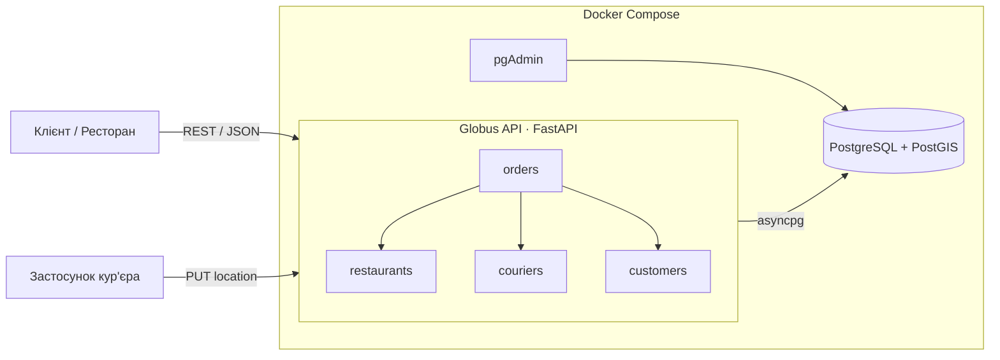
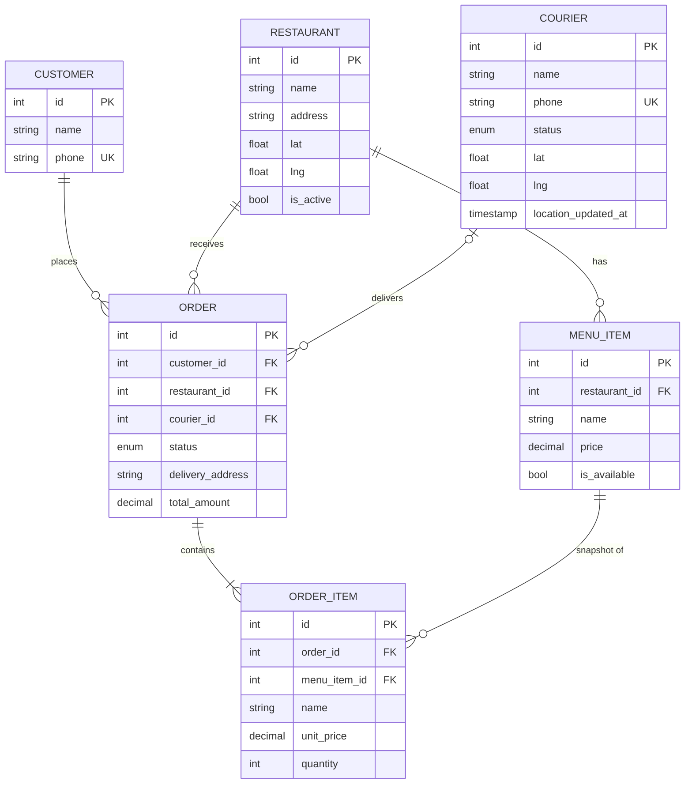
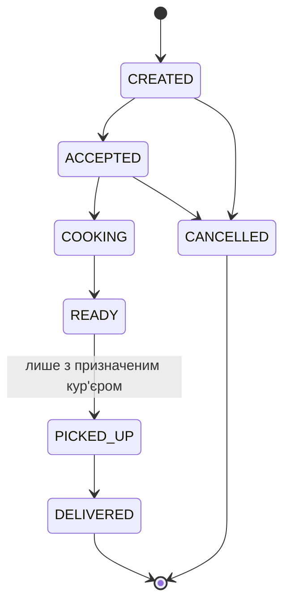
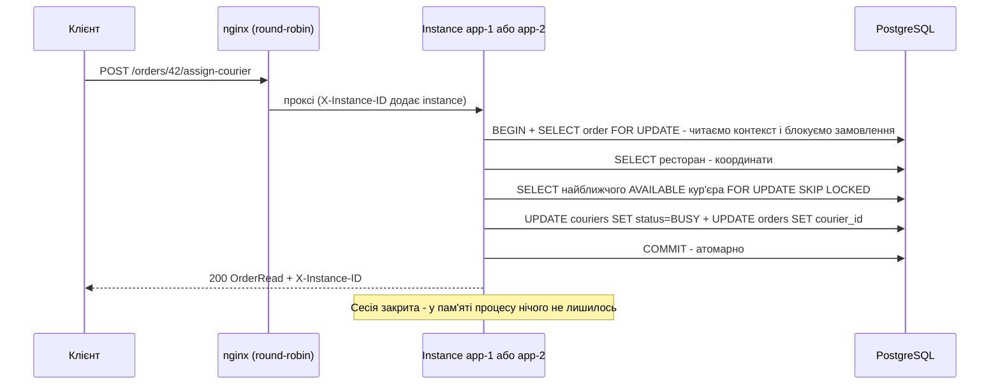
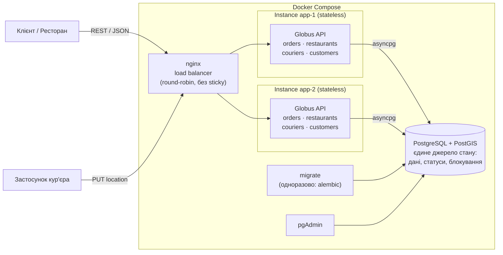

# Globus

**Globus** — високонавантажений сервіс доставки їжі з відстеженням кур'єрів у реальному часі.
Навчальний проєкт з дисципліни «Інженерія високонавантажених систем».

**Стек:** Python 3.12, FastAPI, SQLAlchemy 2.0 (async) + asyncpg, Alembic, PostgreSQL 16 + PostGIS, Docker Compose.

---

## Запуск

Потрібен лише Docker (Docker Desktop на Windows/macOS).

```bash
git clone <repo-url> && cd globus
docker compose up --build
```

Ця команда піднімає PostgreSQL, чекає його готовності (healthcheck), один раз застосовує міграції (сервіс `migrate`), запускає **два instances API** (`app1`, `app2`) та балансувальник nginx. Точка входу не змінилась: `http://localhost:8000` (див. розділ «Лабораторна 2»).

- API (через балансувальник): http://localhost:8000
- Instance 1 напряму: http://localhost:8001, instance 2 напряму: http://localhost:8002
- Swagger UI: http://localhost:8000/docs
- OpenAPI-специфікація: http://localhost:8000/openapi.json
- pgAdmin: http://localhost:5050 (сервер Globus уже налаштований, пароль `globus`)

Демо-дані (3 ресторани з меню, 5 кур'єрів, 2 клієнти):

```bash
docker compose exec app1 python -m app.seed
```

> На Mac з Apple Silicon образ `postgis/postgis` запускається через емуляцію x86. Це працює, але повільніше.

### Перевірка збереження даних (persistence)

```bash
docker compose restart db          # перезапуск контейнера БД
curl localhost:8000/orders/1       # дані на місці
docker compose down && docker compose up -d   # навіть повне перестворення контейнерів
curl localhost:8000/orders/1       # дані на місці, бо лежать у volume pgdata
```

Дані видаляються лише явно: `docker compose down -v`.

---

## Архітектура

**Стиль: модульний моноліт.** Один backend-застосунок, розділений на модулі з чіткими межами: кожен модуль має власні моделі, схеми, сервіс і роутер, а інші модулі звертаються до нього лише через публічні функції сервісного шару (не до його таблиць напряму). Це дає простоту розгортання й транзакційну цілісність на старті, а межі модулів є готовими лініями розрізу для виділення мікросервісів у наступних лабораторних.

### Діаграма контейнерів (C4, Container level)



### Модель даних



Рішення щодо даних:
- `order_items` зберігає **знімок** назви й ціни: зміна меню не змінює історію замовлень.
- Сума замовлення рахується **на сервері** з цін у БД, клієнту не довіряємо.
- Геопошук через PostGIS: координати в колонках `lat/lng`, над виразом `geography`-точки побудовано **GiST-індекси** (`ix_restaurants_location`, `ix_couriers_location`).

### Статусна машина замовлення



Недопустимий перехід повертає `409 Conflict`. Кур'єра можна призначити в статусах ACCEPTED / COOKING / READY. При DELIVERED або CANCELLED кур'єр автоматично звільняється.

---

## API

Повна інтерактивна специфікація: **http://localhost:8000/docs**.

| Метод | Endpoint | Опис |
|---|---|---|
| POST | `/customers` | Реєстрація клієнта |
| GET | `/customers/{id}` | Дані клієнта |
| POST | `/restaurants` | Створення ресторану |
| GET | `/restaurants?lat=&lng=&radius_m=` | Список або **геопошук** ресторанів поруч (з відстанню) |
| GET / PATCH | `/restaurants/{id}` | Отримання / оновлення ресторану |
| POST / GET | `/restaurants/{id}/menu` | Додавання страви / меню ресторану |
| PATCH | `/menu-items/{id}` | Оновлення страви (ціна, доступність) |
| POST | `/orders` | **Створення замовлення** з валідацією та розрахунком суми |
| GET | `/orders?customer_id=&status=` | Список замовлень з фільтрами й пагінацією |
| GET | `/orders/{id}` | Замовлення з позиціями |
| PATCH | `/orders/{id}/status` | **Зміна статусу** через статусну машину |
| POST | `/orders/{id}/assign-courier` | **Призначення найближчого вільного кур'єра** |
| POST | `/couriers` | Реєстрація кур'єра |
| GET | `/couriers/{id}` | Дані кур'єра |
| PUT | `/couriers/{id}/location` | **Оновлення геопозиції** |
| PATCH | `/couriers/{id}/status` | Вихід на лінію (AVAILABLE) / завершення зміни (OFFLINE) |
| GET | `/health` | Перевірка стану сервісу та БД |

**Коди відповідей:** `200`/`201` успіх; `400` некоректний запит; `404` ресурс не знайдено; `409` конфлікт стану (недопустимий перехід статусу, кур'єр уже призначений, дублікат телефону); `422` невалідні дані або порушення бізнес-правила (страва з іншого ресторану, ресторан неактивний).

Формат бізнес-помилки:
```json
{"error": {"code": "conflict", "message": "Cannot change order status from CREATED to READY"}}
```

### Демо-сценарій (curl)

```bash
# Ресторани поруч з точкою
curl "localhost:8000/restaurants?lat=50.445&lng=30.52&radius_m=3000"

# Створити замовлення
curl -X POST localhost:8000/orders -H "Content-Type: application/json" -d '{
  "customer_id": 1, "restaurant_id": 1,
  "delivery_address": "вул. Прикладна, 1", "delivery_lat": 50.44, "delivery_lng": 30.51,
  "items": [{"menu_item_id": 1, "quantity": 2}, {"menu_item_id": 2, "quantity": 1}]
}'

# Прийняти й призначити кур'єра
curl -X PATCH localhost:8000/orders/1/status -H "Content-Type: application/json" -d '{"status":"ACCEPTED"}'
curl -X POST  localhost:8000/orders/1/assign-courier

# Кур'єр надсилає координати
curl -X PUT localhost:8000/couriers/1/location -H "Content-Type: application/json" -d '{"lat":50.446,"lng":30.521}'
```

---

## Піковий сценарій навантаження (High-Load Scenario)

**Обідній пік (12:00–14:00).** Одночасно активні ~5 000 кур'єрів, кожен надсилає `PUT /couriers/{id}/location` кожні 3–5 с, тобто **≈1 000–1 700 записів/с** лише від геолокації. Паралельно хвиля `POST /orders` і `POST /orders/{id}/assign-courier` (геопошук найближчого кур'єра з блокуванням рядка), а клієнти періодично опитують `GET /orders/{id}`, щоб побачити статус.

Найбільш ресурсоємна комбінація: інтенсивний потік записів у таблицю `couriers` + конкурентні геозапити з блокуванням до тієї ж таблиці.

---

## Аналіз вузьких місць (Bottleneck Analysis)

### 1. Оновлення геопозиції кур'єрів: `PUT /couriers/{id}/location`

- **Причина.** Кожне оновлення є транзакцією UPDATE у PostgreSQL: запис у WAL, fsync при коміті, створення нової версії рядка (MVCC). Через MVCC оновлюються також **усі індекси** таблиці, включно з GiST-індексом геолокації, який дорожчий за B-tree. Мертві версії рядків накопичуються швидше, ніж їх прибирає autovacuum (table bloat). Кожен запит займає з'єднання з пулу (у нас 10 + 5 overflow).
- **Симптоматика.** Зростання p99 latency для всіх ендпоінтів (вони ділять той самий пул з'єднань і диск), помилки очікування з'єднання (`QueuePool limit ... timeout`, Connection Pool Exhaustion), високий I/O Wait на сервері БД, падіння throughput при зростанні кількості кур'єрів.

### 2. Призначення кур'єра: `POST /orders/{id}/assign-courier`

- **Причина.** Геопошук + блокування рядка `FOR UPDATE SKIP LOCKED` у тій самій таблиці, яку постійно оновлює пункт 1 (Lock Contention). Під час піку багато замовлень з одного району конкурують за тих самих найближчих кур'єрів: запити пропускають заблоковані рядки й беруть дальших кандидатів, а коли кандидати закінчуються, отримують `409`. Сам геозапит з KNN-сортуванням навантажує CPU БД, а його результат швидко застаріває, бо координати змінюються кожні кілька секунд.
- **Симптоматика.** Зростання частки відповідей `409 No available couriers` при фактично вільних кур'єрах далі від ресторану, зростання CPU БД, збільшення тривалості транзакцій і p99 latency для цього ендпоінта.

### 3. Опитування статусу замовлення: `GET /orders/{id}`

- **Причина.** Клієнти дізнаються про зміну статусу через polling (запит кожні кілька секунд), що множить кількість читань на кількість активних замовлень, хоча статус змінюється рідко. Кожен запит виконує 2 SQL-запити (замовлення + позиції через `selectinload`); без явного eager loading це був би класичний N+1 (у коді заборонено через `lazy="raise"`). Кешу немає, тому кожне читання йде в БД.
- **Симптоматика.** RPS на читання росте лінійно з кількістю активних замовлень, конкуренція за пул з'єднань з операціями запису, зростання latency для всіх користувачів без реальної зміни даних.

### 4. Геопошук ресторанів: `GET /restaurants?lat=&lng=`

- **Причина.** Найпопулярніший запит клієнтів (відкриття застосунку). Обчислення `ST_Distance` для кожного кандидата в радіусі; з великим радіусом у щільному місті індекс повертає багато рядків. Результати однакові для сусідніх точок, але щоразу перераховуються.
- **Симптоматика.** Зростання CPU БД, деградація p95/p99 при великих `radius_m`.

**Напрями оптимізації на наступні етапи:** зберігання актуальних координат кур'єрів у Redis (GEOADD / GEOSEARCH) з періодичним скиданням у БД; кешування меню та результатів геопошуку; асинхронна обробка через чергу повідомлень; заміна polling на WebSocket / SSE; горизонтальне масштабування API за балансувальником; read-репліки PostgreSQL.

---

## Структура проєкту

```
app/
  core/            конфігурація, підключення до БД, обробка помилок, геохелпери
  modules/
    customers/     клієнти
    restaurants/   ресторани, меню, геопошук
    couriers/      кур'єри, геолокація, резервування кур'єра
    orders/        замовлення, статусна машина, призначення кур'єра
  main.py          збирання застосунку
  seed.py          демо-дані
migrations/        міграції Alembic (схема БД, PostGIS, індекси)
nginx/             конфіг балансувальника (round-robin, без sticky sessions)
scripts/           PowerShell-скрипти перевірки cross-instance консистентності та failover
Dockerfile
docker-compose.yml
```

Кожен модуль: `models.py` (ORM), `schemas.py` (валідація Pydantic), `service.py` (бізнес-логіка), `router.py` (HTTP-шар).

---

## Розподіл відповідальності

| Компонент | Заньковський В | Бренькач Д |
|---|----------------|------------|
| Модулі `restaurants`, `customers` | **R**          | C          |
| Модуль `orders`, статусна машина | **R**          | C          |
| Обробка помилок, валідація, OpenAPI | **R**          | C          |
| Модуль `couriers`, геопошук, призначення кур'єра | C              | **R**      |
| Схема БД, міграції, індекси | C              | **R**      |
| Docker / docker-compose, відтворюваність | C              | **R**      |
| Архітектурна схема, аналіз вузьких місць | **R**          | **R**      |
| Code review | **R**          | **R**      |

**R** — відповідальний виконавець, **C** — консультує та переглядає код.


---

## Лабораторна робота № 2: Stateless-архітектура та винесення стану

Мета: підготувати backend до горизонтального масштабування: будь-який instance може обробити будь-який запит, а втрата instance не призводить до втрати даних.

### 1. Звіт про аудит стану (State Audit)

Проаналізовано весь код `app/` (модулі, `core`, `main.py`, `seed.py`) на наявність статичних змінних, in-memory колекцій, локальних кешів, блокувань, лічильників і файлових сесій.

| Елемент у коді | Де | Категорія | Рішення |
|---|---|---|---|
| `engine`, `SessionLocal` (пул з'єднань) | `core/database.py` | **Ephemeral / Local Safe** | Пул з'єднань це інфраструктура процесу, бізнес-даних не містить. Кожен instance має власний пул (10+5), разом 30 з'єднань, що менше за `max_connections=100` у PostgreSQL |
| `settings` (конфіг) | `core/config.py` | **Ephemeral / Local Safe** | Незмінний після старту, береться зі змінних оточення. Додано `instance_id` лише для ідентифікації вузла |
| `ALLOWED_TRANSITIONS`, `ASSIGNABLE_STATUSES`, `COURIER_CANDIDATES_LIMIT` | `orders/service.py`, `couriers/service.py` | **Ephemeral / Local Safe** | Константи (лише читаються), однакові в усіх instances, бо це та сама кодова база |
| `AsyncSession` на запит | `core/database.py::get_session` | **Ephemeral / Local Safe** | Створюється через `Depends` на один запит і закривається. Між запитами нічого не живе |
| Замовлення, позиції, клієнти, ресторани, меню | PostgreSQL | **Shared / Externalized** | Уже зберігається в зовнішній БД (primary DB) |
| Статус і геопозиція кур'єра | PostgreSQL (`couriers`) | **Shared / Externalized** | Те саме. Резервування кур'єра через `FOR UPDATE SKIP LOCKED` це **блокування на рівні БД**, а не в пам'яті процесу, тому працює між instances |
| Блокування замовлення при зміні статусу / призначенні кур'єра | `SELECT ... FOR UPDATE` | **Shared / Externalized** | Розподілений lock через БД (а не `asyncio.Lock`) |
| Сесії користувачів, авторизація | немає | n/a | API не має сесій: кожен запит самодостатній (`customer_id` тощо передаються в тілі). Sticky sessions не потрібні |
| Критичні stateful-залежності (module-level dict/list, кеші, локальні лічильники, файли) | не знайдено | **Critical Stateful Dependencies** | Не виявлено, усувати нічого |

**Перелік усунених залежностей / прихованої affinity** (знайдено при аудиті та виправлено):

1. **Міграції в кожному контейнері.** `CMD` образу виконував `alembic upgrade head` при старті. З двома instances обидва запускали б міграції одночасно (гонка за `alembic_version`). *Виправлено:* міграції винесено в одноразовий сервіс `migrate`, instances стартують після `service_completed_successfully`.
2. **Read-modify-write статусу кур'єра** (`PATCH /couriers/{id}/status`). Було `SELECT` + перевірка `BUSY` у Python + `UPDATE`. Це прихована залежність від того, що між читанням і записом ніхто інший стан не змінить, що з кількома instances хибно: інший вузол міг призначити кур'єра на замовлення (BUSY), а ми перезаписали б статус на AVAILABLE, і кур'єр отримав би друге замовлення. *Виправлено:* перевірка і запис виконуються одним атомарним `UPDATE ... WHERE status != 'BUSY' RETURNING`.
3. **Прив'язка до одного порту/процесу.** Один сервіс `app` з прямою публікацією порту 8000. *Виправлено:* два однакові instances за nginx (round-robin, без `ip_hash` / cookie), порт 8000 тепер належить балансувальнику.

### 2. Stateless Request Flow: «призначення кур'єра» (`POST /orders/{id}/assign-courier`)



- **Вхід:** `order_id` у шляху. Токенів/сесій немає, весь контекст береться з БД.
- **Читання контексту зі shared storage:** замовлення, ресторан, кандидати-кур'єри.
- **Атомарні зміни:** одна транзакція (зміна кур'єра + замовлення). Якщо instance падає до `COMMIT`, PostgreSQL відкочує транзакцію, часткового стану немає.
- **Відсутність залишкових мутацій:** жодних глобальних змінних, кешів чи локальних блокувань. `AsyncSession` живе лише в межах запиту.

### 3. Мульти-екземплярне розгортання та ідентифікація

- Два контейнери з **одного образу**: `app1` (`INSTANCE_ID=app-1`) і `app2` (`INSTANCE_ID=app-2`). Відрізняються лише змінною оточення.
- Кожна відповідь (включно з помилками) містить заголовок **`X-Instance-ID`** (middleware у `app/main.py`). Якщо змінна не задана, використовується hostname контейнера.
- nginx: `upstream` з двох вузлів, round-robin, **без sticky sessions**. При недоступності вузла запит прозоро повторюється на іншому (`proxy_next_upstream error timeout`).

### 4. Оновлена архітектурна схема (C4, Component/Container level)



### 5. Інструкція: локальне розгортання та перевірка

```powershell
docker compose up -d --build        # db, migrate, app1, app2, lb, pgadmin
docker compose ps                   # app1 і app2 мають бути healthy
docker compose exec app1 python -m app.seed   # (необов'язково) демо-дані
```

**Автоматичні перевірки (PowerShell):**

```powershell
.\scripts\test_cross_instance.ps1          # POST->app-1, GET->app-2, PATCH->app-2, GET->app-1 + розподіл через LB
.\scripts\test_failover.ps1                # зупинка app-1 посеред сценарію (docker compose stop)
.\scripts\test_failover.ps1 -Mode kill     # аварійно (SIGKILL)
```

Якщо PowerShell забороняє запуск скриптів: `Set-ExecutionPolicy -Scope Process Bypass`.

**Ручна перевірка cross-instance консистентності (cURL).** Порт 8001 це app-1, 8002 це app-2 (у PowerShell використовуйте `curl.exe`, а в JSON екрануйте лапки або беріть дані з файлу `-d "@order.json"`):

```bash
# 1) створити замовлення на instance 1
curl -i -X POST localhost:8001/orders -H "Content-Type: application/json" -d '{
  "customer_id": 1, "restaurant_id": 1, "delivery_address": "вул. Прикладна, 1",
  "delivery_lat": 50.44, "delivery_lng": 30.51,
  "items": [{"menu_item_id": 1, "quantity": 2}]}'          # X-Instance-ID: app-1

# 2) прочитати на instance 2
curl -i localhost:8002/orders/1                              # X-Instance-ID: app-2, статус CREATED

# 3) змінити статус на instance 2
curl -i -X PATCH localhost:8002/orders/1/status -H "Content-Type: application/json" -d '{"status":"ACCEPTED"}'

# 4) прочитати на instance 1: бачить зміну, зроблену instance 2
curl -i localhost:8001/orders/1                              # X-Instance-ID: app-1, статус ACCEPTED

# 5) через балансувальник: заголовок чергується
curl -si localhost:8000/orders/1 | findstr /i "X-Instance-ID"
```

**Сценарій втрати instance вручну:**

```powershell
docker compose kill app1                  # аварійна зупинка app-1 (або: docker compose stop app1)
curl.exe -i localhost:8000/orders/1       # відповідає app-2, дані на місці
curl.exe -i -X PATCH localhost:8000/orders/1/status -H "Content-Type: application/json" -d "{\"status\":\"COOKING\"}"
docker compose start app1
curl.exe -i localhost:8001/orders/1       # app-1 одразу бачить актуальний стан
```

Нюанси: після зупинки вузла перший запит може тривати до `proxy_connect_timeout` (2 с), потім nginx на 10 с виводить вузол з ротації. Запит, який саме виконувався на вбитому вузлі, може завершитись помилкою `502`: клієнт має його повторити. Завдяки транзакціям (все або нічого) часткових змін у БД не лишається.

### 6. Відповіді для теоретичного опитування

- **Stateless це не «немає даних».** Дані є й критично важливі, але вони живуть поза процесом (у PostgreSQL). Stateless означає, що *процес* не зберігає між запитами нічого, від чого залежить коректність: його можна замінити, перезапустити чи розмножити.
- **Прихована affinity** це ситуація, коли система «працює», доки запити одного клієнта потрапляють на один вузол: локальний кеш, `dict` із сесіями, `asyncio.Lock`, файл на диску, лічильник у пам'яті, sticky-cookie балансувальника. Ризики: різні відповіді різних вузлів, втрата стану при рестарті, дубль обробки, неможливість зменшити/збільшити кількість вузлів. Виявляється саме тестом, де запити свідомо розкидані по різних instances (наш `test_cross_instance`).
- **Консистентність.** Усі instances читають і пишуть в одну PostgreSQL: консистентність забезпечується транзакціями, `SELECT ... FOR UPDATE` та атомарними `UPDATE ... WHERE` (приклад: виправлення `set_status`).
- **Вузьке місце, яке з'являється.** Stateless-шар масштабується горизонтально, але БД стає єдиною точкою (див. напрями оптимізації вище: Redis, репліки, черги).
